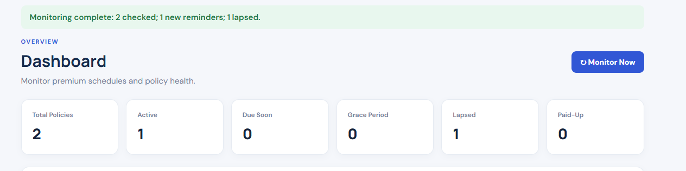
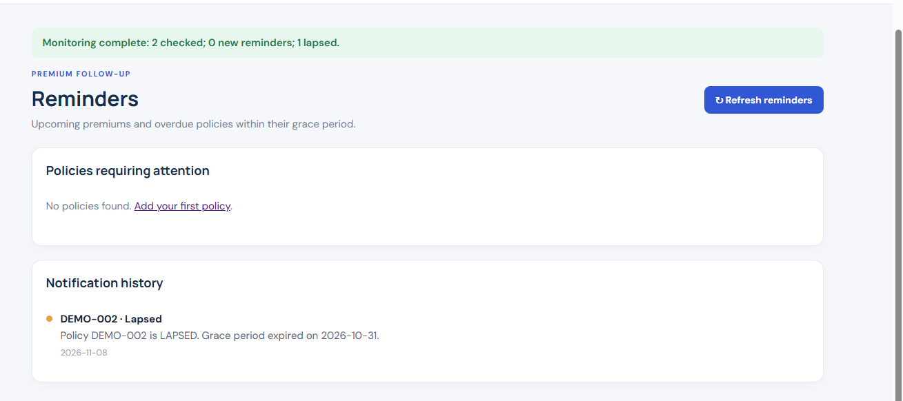

# Insurance Premium Notifier

A Flask and SQLite web application for managing insurance policies, tracking premium due dates, and reviewing policy status.

> Academic project / local demonstration. The application currently creates reminders in its database when you manually run **Monitor Now**; it does not send email or SMS messages.

## Features
- Create, view, edit, and delete insurance policies
- Store policyholder name, contact details, premium amount, payment frequency, and payment dates
- Support monthly and yearly premium schedules
- Calculate the next due date, including month-end and leap-year cases
- Configure a grace period for each policy
- Classify policies as **Active**, **Due Soon**, **Grace Period**, or **Lapsed**
- Record a premium payment and recalculate the next due date
- Mark a policy as **Paid-Up** and exclude it from reminder/lapse checks
- Review dashboard totals and notification history
- Manually refresh policy statuses with **Monitor Now**

## Tech stack
- Python
- Flask
- SQLite
- Jinja2 templates
- HTML and CSS
- unittest for date/status logic tests

## Repository structure

```text
Insurance-Premium-Notifier/
├── app.py                  # Flask routes and application entry point
├── database.py             # SQLite connection and schema initialization
├── services.py             # Due-date, status, and monitoring logic
├── requirements.txt        # Python dependencies
├── run.bat                 # Windows launch helper
├── run.sh                  # macOS/Linux launch helper
├── database/
│   └── insurance.db        # SQLite database file
├── templates/              # Jinja2 page templates
├── static/
│   └── style.css           # Application styles
├── tests/
│   └── test_services.py    # Date and policy-status tests
├── screenshots/            # Add application screenshots here
└── README.md
```

## Getting started

### 1. Clone the repository

```bash
git clone https://github.com/mhlabz/Insurance-Premium-Notifier.git
cd Insurance-Premium-Notifier
```

### 2. Create and activate a virtual environment

**Windows PowerShell:**

```powershell
python -m venv .venv
.\.venv\Scripts\Activate.ps1
```

If PowerShell blocks activation, use Command Prompt instead:

```cmd
.venv\Scripts\activate.bat
```

**macOS / Linux:**

```bash
python3 -m venv .venv
source .venv/bin/activate
```

### 3. Install dependencies

```bash
python -m pip install -r requirements.txt
```

### 4. Run the application

```bash
python app.py
```

Open [http://127.0.0.1:5000](http://127.0.0.1:5000) in your browser.

The SQLite database is configured at database/insurance.db. The application initializes the required tables when it starts.

## Run the tests

From the repository root, with the virtual environment activated:

```bash
python -m unittest discover -s tests -v
```

The current test suite covers monthly/yearly date calculations, month-end and leap-year handling, and policy status boundaries.

## Policy status rules

| Status | Rule |
|---|---|
| Active | Due date is more than 7 days away |
| Due Soon | Due date is within the next 7 days, including today |
| Grace Period | Due date has passed, but the grace deadline has not |
| Lapsed | The grace deadline has passed |
| Paid-Up | Manually marked as paid-up; excluded from monitoring |

Use **Monitor Now** on the dashboard or **Refresh reminders** on the Reminders page to recalculate statuses and create notification-history entries. Duplicate notification types for the same policy and due date are prevented by a database uniqueness constraint.

## Application screenshots

Here are screenshots of the application interface:

### Dashboard


### All Policies


### Reminders


### Lapsed Policies


The screenshot files are stored in the [screenshots folder](screenshots/README.md). A capture of the Add Policy form can be added there as well.

For a short demo GIF, record a quick walkthrough showing the dashboard, adding a sample policy, and refreshing reminders. Do not include real customer contact details or policy numbers.

## Configuration and safety

- Set a strong SECRET_KEY environment variable before exposing the app beyond a local demo. The built-in fallback key is for development only.
- Do not commit real customer information, credentials, environment files, or personal database backups.
- This project is an educational prototype, not a production insurance-management or notification service.

## Author

**GitHub:** [@mhlabz](https://github.com/mhlabz)

## License

No open-source license has been specified. All rights remain with the project author unless a license is added.